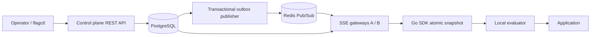

# FlagForge

FlagForge is a Go feature management platform with a transactional control plane and an independently available SDK data plane. Applications evaluate typed flags locally; background synchronization delivers configuration without an application restart.

## Features

- Boolean, string, integer, float and JSON flags with independent environment configuration.
- Explicit targets, exclusion lists, ordered attribute rules, reusable environment-scoped segments, prerequisites and cycle validation.
- Deterministic SHA-256 percentage and multivariation rollouts using 100,000 buckets.
- PostgreSQL transactions covering configuration, environment revision, immutable audit history and transactional outbox.
- Redis Pub/Sub for cross-instance notifications, version-qualified snapshot caching, SSE, periodic reconciliation and ETags.
- Go SDK with immutable atomic snapshots, local evaluation, bootstrap, offline mode, initialization status, reconnect backoff, polling and bounded asynchronous analytics.
- Optimistic concurrency, protected production environments, hashed tokens, Viewer/Developer/Admin roles and overlapping SDK key rotation.
- Multi-worker scheduled changes, linked gradual rollout stages, conflict protection, rollback and readable audit diffs.
- Prometheus, OTLP traces, slog, optional authenticated pprof, CLI, demo, load runner, Docker Compose and CI.

## Architecture



The control plane prioritizes authorization and durable, serialized writes. The data plane prioritizes availability and frequent lock-free reads. PostgreSQL is authoritative; Redis is an optimization. REST and SSE suffice for this deployment: no extra internal RPC service requires gRPC.

## Quick start

Docker and Docker Compose are enough to run the platform. Go 1.23+ is required for native development; CI and the container use Go 1.25.

```bash
export FLAGFORGE_ADMIN_TOKEN="api_admin_$(openssl rand -hex 24)"
docker compose up -d --build
curl http://localhost:18080/readyz
```

PowerShell:

```powershell
$env:FLAGFORGE_ADMIN_TOKEN = 'api_admin_' + [guid]::NewGuid().ToString('N') + [guid]::NewGuid().ToString('N')
docker compose up -d --build
Invoke-RestMethod http://localhost:18080/readyz
```

A local `.env` can hold `FLAGFORGE_ADMIN_TOKEN`; it is excluded from Git and Docker build context. Keep the same token across restarts. The local deployment exposes PostgreSQL on **15432**, Redis on **16379**, API on **18080**, and a second API on **18082** with `--profile multi`. PostgreSQL and Redis container ports remain 5432 and 6379. Host ports can be changed with `FLAGFORGE_POSTGRES_PORT`, `FLAGFORGE_REDIS_PORT`, `FLAGFORGE_API_PORT`, `FLAGFORGE_API_B_PORT` and `FLAGFORGE_EXAMPLE_PORT`. The local `.env` generated here selects API **28080**, second API **28082** and example **28081**, avoiding other projects. Container/native server ports remain 8080/8081. Demo scripts read `.env`; adjust curl and SDK endpoints to its host ports.

Run the full demonstration (project, production environment, disabled checkout, 10% → 50%, immediate kill switch):

```bash
bash scripts/demo.sh
# requires curl, jq, openssl, Docker
```

```powershell
powershell -NoProfile -ExecutionPolicy Bypass -File scripts/demo.ps1
# -SkipBuild uses an already running server
```

The example service listens on `http://localhost:18081/checkout?user=user-1`. The demo prints observed assignments and waits for each SDK revision. Services remain running; stop them with `docker compose --profile demo --profile multi down`. This preserves the PostgreSQL volume.

For a local Go server, set `FLAGFORGE_ADMIN_TOKEN` and run `go run ./cmd/flag-server -config configs/local.yaml`. ENV overrides YAML. Goose migrations are embedded, automatically run under a PostgreSQL advisory lock, and can be run alone with `-migrate-only`.

## How evaluation works

1. Missing flag, cancelled context or typed API mismatch returns the caller fallback.
2. Disabled flag returns its off variation.
3. Prerequisites must return the specified variation.
4. Explicit exclusions win over inclusions; inclusions name a variation.
5. Rules use AND across conditions and segment references. Lower priority wins; equal priority uses rule ID.
6. A nonempty subject key receives a deterministic rollout variation.
7. Otherwise the default variation wins.

Segments use OR across their rules and AND within each rule; explicit segment exclusion wins. Segment and prerequisite dependency graphs are validated. An empty subject key never enters percentage rollout. Operators and reasons are documented in [evaluation-engine.md](docs/evaluation-engine.md).

Percentage assignment hashes length-delimited flag key, `project/environment`, and subject key using SHA-256. The first 64 bits map to `[0,99999]`. Ordered variation weights must total exactly 100000. Repeating the same configuration and subject repeats the result; expanding the first variation's range keeps its previous population. Arbitrary multivariation edits can reassign users. Persistent sticky assignment is a separate roadmap feature.

## API

Every management endpoint requires `Authorization: Bearer <API token>`. SDK endpoints accept only environment SDK keys. Keys are returned once and stored as SHA-256 hashes.

```bash
curl -H "Authorization: Bearer $FLAGFORGE_ADMIN_TOKEN" \
  -H 'Content-Type: application/json' -X POST http://localhost:18080/api/v1/projects \
  -d '{"key":"payments","name":"Payments"}'
```

Create an environment with `POST /api/v1/projects/payments/environments`, using `{"key":"production","name":"Production"}`. Its response includes `sdk_key`. Create a flag with `POST /api/v1/projects/payments/flags`, using `{"key":"new-checkout","name":"New checkout","type":"BOOLEAN"}`. Configure it:

```bash
curl -H "Authorization: Bearer $FLAGFORGE_ADMIN_TOKEN" \
  -H 'Content-Type: application/json' -H 'If-Match: 0' -X PUT \
  http://localhost:18080/api/v1/projects/payments/environments/production/flags/new-checkout \
  -d '{"type":"BOOLEAN","enabled":true,"variations":{"on":true,"off":false},"default_variation":"off","off_variation":"off","rollout":[{"variation_key":"on","weight":10000},{"variation_key":"off","weight":90000}]}'
```

`If-Match` is the current **flag configuration** version (0 for creation); updates return a new version. Segment writes use the **environment snapshot** version. Missing preconditions return 428; stale versions return 409. [API reference](docs/control-plane.md) describes endpoints and schedule bodies.

## Go SDK

```go
client, err := sdk.NewClient(sdk.Config{
    SDKKey: os.Getenv("FLAGFORGE_SDK_KEY"),
    Endpoint: "http://localhost:18080",
    WaitForInitial: true,
    BootstrapFlags: map[string]any{"new-checkout": false},
})
if err != nil { return err }
defer client.Close()

user := sdk.Subject{Key: "user-123", Attributes: map[string]any{"country": "DE", "plan": "premium"}}
enabled := client.BoolVariation(ctx, "new-checkout", user, false)
```

Import `github.com/flagforge/flagforge/pkg/sdk`. Also available: `StringVariation`, `IntVariation`, `FloatVariation`, `JSONVariation`, detailed `Evaluate`, `Ready` and `Status`. JSON results are copied to preserve snapshot ownership. Integer values are constrained to exact JSON numeric range ±(2^53−1). `Mode: sdk.Polling` disables SSE; `Offline: true` disables synchronization. `Close` cancels and joins workers.

## Real-time updates, offline behavior and consistency

SDK synchronization performs HTTP requests; evaluation never does. Reconnection subscribes before fetching a complete snapshot, closing the subscribe/snapshot gap. A periodic poll runs alongside streaming, and gateway heartbeats reconcile database versions independently of Redis. Older or duplicate snapshots cannot overwrite newer SDK state.

Control plane and SDKs are eventually consistent. With healthy infrastructure, a commit normally propagates after the outbox polling interval (default 500 ms) plus publication, snapshot fetch and network latency. This is a characteristic, not a guaranteed SLA. Redis loss falls back to gateway reconciliation (15 seconds) and SDK polling (30 seconds). Outages retain the last known configuration; applications use caller defaults before successful initialization. A flag service outage must not become an application outage. A disconnected kill switch can remain stale; use a separate mechanism when a hard safety deadline is required.

Outbox delivery is at-least-once. Redis Pub/Sub itself is transient, so successful publication does not prove that every SDK received the event. Full snapshots and revision reconciliation provide recovery. [Failure modes](docs/failure-modes.md) explain limits and recovery.

## Security and observability

Production is protected automatically. Viewer reads; Developer edits existing configurations and segments only in unprotected development/staging; Admin manages definitions, tokens, schedules and production. All management paths authenticate on every request. SDK streams revalidate keys on each heartbeat. Raw keys and subject attributes are absent from logs, audit and analytics. [Security model](docs/security.md) covers rotation and deployment boundaries.

Use `docker compose --profile observability up -d` for Prometheus (`:19090`) and Grafana (`:13000`) with a provisioned datasource and dashboard. OTLP traces are sent to the included collector and its debug exporter. Metrics use bounded route families and evaluation reasons; usage details are queried from PostgreSQL. `/healthz` is process liveness; `/readyz` checks PostgreSQL. Redis failure does not make the server unready. pprof is disabled by default, enabled in the local Compose configuration, and requires Admin authentication.

## Testing and performance

```bash
make build
make test
make test-race
make lint
make integration  # Docker required; Testcontainers creates PostgreSQL/Redis
make benchmark
go run ./cmd/loadtest -n 100000000
```

Integration tests cover Redis delivery between independent gateways, optimistic conflicts, outbox failure/retry, RBAC, segments, rollback, multi-worker schedules, gradual stages, audit immutability, analytics and key rotation. Tests can use dedicated existing services via `INTEGRATION_DATABASE_DSN` and `INTEGRATION_REDIS_ADDRESS`. Never point integration tests at a production database.

CI checks formatting, vet, golangci-lint, unit/race tests, binary and Docker builds, plus a separate integration job with PostgreSQL and Redis services. Measured results, methodology and propagation runs for 10/100/1000 SDKs are recorded in [benchmarks.md](docs/benchmarks.md).

CLI examples:

```bash
go run ./cmd/flag-cli projects list
go run ./cmd/flag-cli flags list --project payments
go run ./cmd/flag-cli flags rollout --project payments --env production --flag new-checkout --percentage 10
go run ./cmd/flag-cli audit list --project payments
```

## Engineering notes and roadmap

[Architecture](docs/architecture.md), [SDK](docs/sdk.md), [outbox](docs/outbox.md), [consistency](docs/consistency.md), [streaming](docs/streaming.md) and [rollouts](docs/rollouts.md) explain implementation choices. [Implementation phases](docs/implementation.md) maps the staged work to files and verification.

Optional extensions remain outside the implemented core: OpenFeature provider, persistent assignments, approval workflows, GitOps, browser UI, organization tenancy, external language SDKs, Kafka/Redis Streams, multi-region routing and Helm. Analytics is best-effort usage telemetry, not an experimentation statistics engine. The core supports rollback to any retained flag configuration revision and readable top-level diffs.
