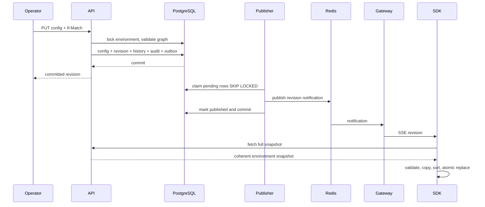

# Architecture

`cmd/flag-server` composes PostgreSQL repositories, Redis, bounded notification hub, HTTP API and background workers. `pkg/evaluation` is pure and shared with `pkg/sdk`; importing the SDK does not import server persistence. `cmd/example-service` demonstrates local evaluation. `cmd/flag-cli` and `cmd/loadtest` exercise management and distribution.

Transactions serialize per environment rather than globally. Full snapshot reads use repeatable-read transactions so segments, flags and environment revision come from one database view. Redis entries include revision in their key; API consults the database revision before cache access. Old entries expire rather than being overwritten concurrently.

Domain entities and rule/condition/variation records are normalized. Flexible target maps, rollouts, prerequisite lists and history use JSONB. Segments are environment-scoped to preserve independent environment state. Flag definition type is immutable; archive preserves history and removes the flag from SDK snapshots.

For a million SDK connections, separate gateway processes from management workers, consume one notification subscription per gateway, cache/fan out one snapshot per environment, shard by environment, put streaming-friendly load balancing in front, and bound simultaneous reconnects. Current heartbeats query PostgreSQL per connection; this implementation deliberately does not claim million-client capacity. For multiple regions, replicate immutable snapshots and notifications regionally, keep a primary write region, and accept regional staleness during partitions.
