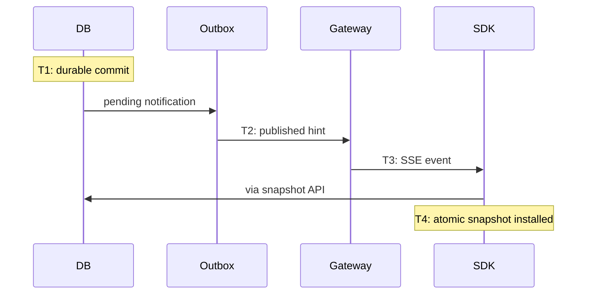

# Consistency and partition behavior

The management transaction is the consistency boundary. Configuration, revision, history, audit and outbox either all commit or none do. Environment row locking makes dependency validation and concurrent flag/segment edits serializable within the environment. A flag `If-Match` detects stale clients even though an environment may have changed other flags.

SDK evaluation prefers availability during partitions, using last-known configuration. This sacrifices freshness, not snapshot coherence. Strong remote consistency on every evaluation would couple application latency and availability to network/database health. There is no hard bound on staleness while all synchronization paths are down; status lets applications impose their own policy.

Polling and heartbeat reconciliation bound normal recovery after network restoration. Healthy delivery depends on configured outbox tick, network, database and snapshot cost. Notification duplicates and out-of-order responses are safe. Database rollback to an older environment revision is not silently accepted by existing SDKs: restore version counters above previously distributed revisions or restart/rebootstrap clients under an operational recovery plan.
