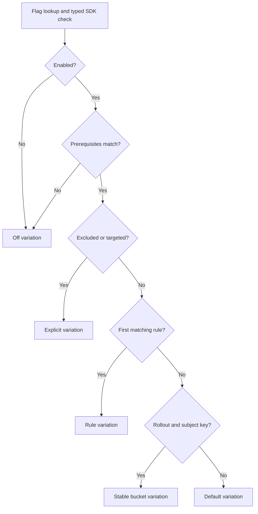

# Evaluation engine

The evaluator consumes an immutable snapshot and a subject. It never performs network or database I/O. SDK snapshot publication validates references, sorts flag rules and makes an owned copy before the atomic CAS. Reads load a single pointer, keeping prerequisites and segments coherent throughout evaluation.

Reasons: `FLAG_DISABLED`, `DEFAULT`, `TARGET_MATCH`, `RULE_MATCH`, `ROLLOUT`, `PREREQUISITE_FAILED`, `ERROR`. Results include variation, rule ID and the flag's environment revision. Missing configuration and type mismatch return caller fallback with ERROR.

Rules AND conditions and referenced segments. Segments OR their rules; exclusion wins over inclusion. Lower rule priority wins, ties use lexicographic ID. Prerequisites compare variation keys rather than loosely coercing values. A disabled prerequisite can satisfy an explicitly requested off variation. Recursive evaluation has a depth guard; configuration validation rejects cycles and excessive depth.

Operators: `equals`, `not_equals`, `in`, `not_in`, `contains`, `not_contains`, `starts_with`, `ends_with`, `greater_than`, `greater_or_equal`, `less_than`, `less_or_equal`, `exists`, `not_exists`. Numeric comparisons accept numeric Go/JSON values, never numeric strings. String operations are case-sensitive. `key` accesses subject identity. Missing attributes match only `not_exists`; they do not match negative comparisons. Empty rules and malformed operands are rejected. Semver operators are an optional extension.

Booleans and strings require exact types. Integers must be integral and within ±(2^53−1), avoiding silent wire rounding. Floats reject NaN/infinity. JSON values must marshal. SDK JSON/detailed results copy map and slice values, preventing clients from mutating shared configuration.
